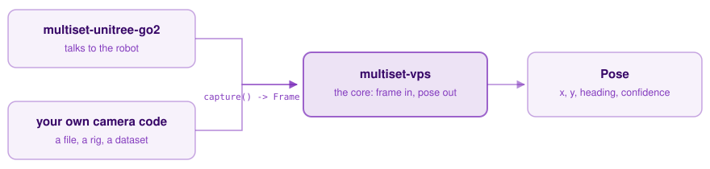

<a href="https://multiset.ai"></a>

# multiset-python

**The MultiSet Python SDKs.** Work out where a camera is from a single picture,
anywhere you have already mapped with MultiSet.

No GPS, no markers on the walls, no beacons, no extra hardware. You send a
photo; you get back where it was taken and which way the camera was facing.

[Developer Platform](https://developer.multiset.ai) ·
[Docs](https://docs.multiset.ai) ·
[multiset.ai](https://multiset.ai)

That is useful wherever GPS cannot reach — indoors, underground, in a warehouse.
It is how you snap a drifting robot back onto the truth, how a machine that has
just booted works out where it is, and how you record where something you
photographed actually stands.

**You will need a MultiSet account first.** Sign up at the
[Developer Platform](https://developer.multiset.ai), create a map, and keep your
**client ID**, **client secret** and **map code** to hand — each package README
shows where they go.

## See it working

<a href="https://youtu.be/ASAuUXez41o">
  
</a>

**[Fixing Unitree Go2 Localization Drift with 6DoF VPS](https://youtu.be/ASAuUXez41o)** — on YouTube.

---

# The packages

| | package | install as | import as |
|---|---|---|---|
| **1** | [the core](packages/vps/README.md) | `multiset-vps` | `multiset.vps` |
| **2** | [Unitree Go2](packages/unitree-go2/README.md) | `multiset-unitree-go2` | `multiset.unitree.go2` |
| **3** | [Insta360 360 cameras](packages/insta360/README.md) | `multiset-insta360` | `multiset.insta360` |

More adapters will land alongside these. The core never changes when they do.

## 1 · `multiset-vps` — positioning, for any camera

<picture>
  <source media="(prefers-color-scheme: dark)" srcset="docs/img/vps-dark.svg">
  
</picture>

**What it is for.** Turning a picture into a position. This is the whole product
in one function call.

**What you get back.** A `Pose` — `x`, `y`, `z`, a heading, and a confidence. If
the map does not recognise the picture, you get a `Pose` that is simply empty,
not an exception.

```python
from multiset.vps import localize_image

pose = localize_image(image, my_lens_numbers)
if pose:
    print(pose.x, pose.y, pose.yaw_deg)
```

Three dependencies, no hardware.

**Everything else — installing it, configuring it, worked examples, the frame
conventions and the full API — is in
[packages/vps/README.md](packages/vps/README.md).**

## 2 · `multiset-unitree-go2` — for the Unitree Go2

<picture>
  <source media="(prefers-color-scheme: dark)" srcset="docs/img/go2-dark.svg">
  
</picture>

**What it is for.** Getting that same position out of a Unitree Go2, without you
writing any of the hard parts.

**What it does for you.** Finds the robot on your network, connects over WebRTC,
pulls a frame from the front camera, straightens out the fisheye using this
robot's own measured calibration, and localizes it.

**What you get back.** The same `Pose` — plus `dog.base_pose()` if you want the
robot's position rather than the lens's.

```python
from multiset.unitree.go2 import Go2

with Go2.from_env() as dog:
    pose = dog.localize()
    if pose:
        print(pose.x, pose.y, pose.yaw_deg, pose.confidence)
```

Builds on the core.

**Everything else — installing it, finding the robot, the AES key, the seven
steps and the things that will cost you an afternoon — is in
[packages/unitree-go2/README.md](packages/unitree-go2/README.md).**

## 3 · `multiset-insta360` — for Insta360 360 cameras

**What it is for.** Localizing with a 360 camera instead of a normal one. One
panorama sees the whole room, so there is no aiming and **nothing to
calibrate** — an equirectangular frame is described by its own shape, so the
service needs no lens numbers at all.

**What it does for you.** Finds the camera, checks it really is in 360 mode,
pulls stitched equirect frames, and chains the search hints so each fix makes
the next one faster.

**Where the camera is does not matter.** On your laptop over USB, or plugged
into a robot and read over SSH — same class shape, one line different, and
nothing is installed on the robot.

```python
from multiset.insta360 import SSHCamera
from multiset.vps import localize

with SSHCamera("unitree@192.168.123.18") as cam:
    pose = localize(cam)          # sent as an equirect query, no intrinsics
```

**Everything else — webcam mode, the robot setup, hint chaining and the cold
start — is in [packages/insta360/README.md](packages/insta360/README.md).**

---

One naming rule, no exceptions: **every hyphen after `multiset` becomes a dot.**
`multiset-unitree-go2` imports as `multiset.unitree.go2`.

## The core / adapter split

<picture>
  <source media="(prefers-color-scheme: dark)" srcset="docs/img/packages-dark.svg">
  
</picture>

One core plus N adapters, not N independent SDKs. The contract between them is
one method:

```python
class FrameSource(Protocol):
    def capture(self) -> Frame: ...      # Frame = (rectified image, intrinsics)
```

Everything device-agnostic — `localize()`, `Pose`, `Mount`, `Rectifier` — is
written against that, which is why adding a camera costs nothing in the core.
The rule for where new code goes: **anything a second device would also need
belongs in `multiset.vps`.** Core owns the maths, adapters own the measurements.

## Layout

```
multiset-python
├─ pyproject.toml            uv workspace + lint/type/test config
├─ packages/                 one directory per distribution, each with examples/
│  ├─ vps/                   multiset-vps
│  └─ unitree-go2/           multiset-unitree-go2
├─ docs/frames.md            the conversions that are silent when wrong
└─ .github/workflows/  ci.yml · release.yml
```

`src/multiset/` and `src/multiset/unitree/` are PEP 420 namespace directories.
**Neither may ever contain an `__init__.py`** — one does, and every sibling
`multiset.*` distribution becomes unimportable with a `ModuleNotFoundError` that
points nowhere near the cause. CI and a unit test both guard it.

## Working on this repo

```bash
uv sync --all-extras     # both packages editable in one venv
uv run pytest
```

Editing `packages/vps/src/multiset/vps/frames.py` is live in the adapter
immediately — no version bump, no reinstall. That is the property a monorepo buys
and separate repos charge for.

Python 3.10–3.12 is what CI runs. Prerequisites, the namespace rule and the
pre-PR checklist are in [CONTRIBUTING.md](CONTRIBUTING.md).

## Versioning and releases

Each package versions independently. Releases are driven entirely by **tag
prefix**:

```bash
git tag unitree-go2-v0.2.1 && git push --tags   # publishes only that package
git tag vps-v0.1.1 && git push --tags          # publishes only the core
```

`hatch-vcs` derives the version from that tag with a `--match` per package, so
one package can never pick up another's version. `release.yml` builds, verifies
the wheel version equals the tag, and attaches artifacts. The
`PUBLISH_TO_PYPI` repository variable controls trusted publishing.

Adapters pin the core on a compatible range (`multiset-vps>=0.1,<0.2`), never a
`git+` URL: a direct reference in `[project.dependencies]` cannot be uploaded.

## Licence

Apache-2.0. See [LICENSE](LICENSE) and [NOTICE](NOTICE).

The Unitree Go2 3D model is **not** redistributed — the viz extra downloads it
on demand into a local cache. CI fails the build if it ever appears in a wheel.

Unitree and Go2 are trademarks of their respective owner. This project is not
affiliated with or endorsed by Unitree.
