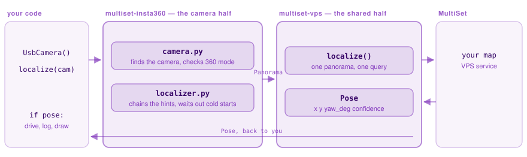

# multiset-insta360

### One 360 frame sees the whole room. Ask it where that room is.

Part of [multiset-python](../../README.md). This package is the Insta360
**adapter** — it owns getting equirectangular frames off the camera, whether it
is on your desk or on a robot. The positioning itself, the `Pose`, and the
equirect query live in [`multiset-vps`](../vps/README.md).

<picture>
  <source media="(prefers-color-scheme: dark)" srcset="../../docs/img/insta360-dark.svg">
  
</picture>

**What it is for.** Localizing with a 360 camera instead of a normal one. A
panorama sees in every direction at once, so there is no aiming, no worrying
about which way the camera points, and far less to go wrong.

**What it does for you.** Finds the camera, checks it is actually in 360 mode,
pulls stitched equirectangular frames, sizes them for the query endpoint, and
chains the hints so each fix makes the next one faster.

**What you get back.** The same `Pose` every MultiSet package returns — `x`,
`y`, `z`, a heading, and a confidence.

**What you need first.** An Insta360 X-series camera, a USB cable, and your
MultiSet credentials. No Insta360 SDK: in webcam mode the camera is a standard
UVC device that has already done the stitching.

### Where your code stops and ours starts

<picture>
  <source media="(prefers-color-scheme: dark)" srcset="../../docs/img/insta360-modules-dark.svg">
  
</picture>

Two lines of yours drive all of it. This package owns getting a panorama off the
camera — wherever the camera is. The positioning half is
[`multiset-vps`](../vps/README.md), shared with every other device.

## Which cameras work

The X3, X4 and X5 all work — nothing here is tied to one model. What the code
actually requires is two things:

1. the camera appears as a **standard UVC device** (an ordinary webcam), and
2. its frames are **2:1** — meaning the camera is stitching for you.

Every X-series model satisfies both in webcam mode. Auto-discovery finds them by
name on Linux, and otherwise takes the first 2:1 device it sees — so a non-
Insta360 camera that stitches to equirect over UVC will also work if you name
the device yourself:

```python
UsbCamera(device=1)  # or '/dev/video2' on Linux
```

A feed that is not 2:1 is refused with `NotPanoramic` rather than uploaded,
because it cannot localize.

**You do not need a camera class at all.** Any 2:1 image localizes directly:

```python
import cv2
from multiset.vps import localize_panorama

pose = localize_panorama(cv2.imread("panorama.jpg"))
```

## No intrinsics, and that is the point

A normal camera query needs the four numbers describing your lens, and getting
them wrong puts every bearing out by about 10%. An equirectangular frame is
fully described by its own 2:1 shape, so **there is nothing to calibrate and
nothing to get wrong.** The service works out the geometry itself — it renders
perspective views out of the panorama and solves them together as a rig.

One consequence worth knowing: equirect queries are *not* subject to the
1280 px limit that pinhole queries are. Panoramas go up at up to 4096x2048,
because squeezing one into 1280x640 throws away what the solver needs.

---

# Getting started

## 1 · Install it

```bash
pip install \
  "multiset-vps @ git+https://github.com/MultiSet-AI/multiset-python@vps-v0.1.0#subdirectory=packages/vps" \
  "multiset-insta360 @ git+https://github.com/MultiSet-AI/multiset-python@insta360-v0.1.0#subdirectory=packages/insta360"
```

Both lines are required: pip does not follow a git URL to find the core.

## 2 · Put the camera in 360 webcam mode

Plug it in over USB. The camera's own screen shows a mode prompt — choose
**Webcam mode → 360 view**. It then appears as an ordinary video device
delivering stitched 2:1 frames (2880x1440 on the X5).

This step is easy to miss, and single-lens mode looks like a working camera
until the query fails. If the shape is not 2:1, this package raises
`NotPanoramic` and says so rather than sending a frame that cannot localize.

## 3 · Add your credentials

Copy [`.env.example`](../../.env.example) to `.env` and fill in
`MULTISET_CLIENT_ID`, `MULTISET_CLIENT_SECRET` and `MULTISET_MAP_CODE` — from
the [Developer Platform](https://developer.multiset.ai).

## 4 · Get a pose

```python
from multiset.insta360 import UsbCamera
from multiset.vps import localize

with UsbCamera() as cam:
    print(f"camera up: {cam.resolution[0]}x{cam.resolution[1]} equirect")
    pose = localize(cam)
    if pose:
        print(f"x={pose.x:.2f}  y={pose.y:.2f}  facing {pose.yaw_deg:.0f}°")
    else:
        print("the map did not recognise this frame")
```

**The first query can take a couple of minutes** while the query GPU wakes from
idle; every one after it takes a few seconds. `Localizer` handles that waiting
for you — see below.

---

# The camera on a robot

If the Insta360 is plugged into a robot instead of your laptop, swap one class.
Everything still runs on your machine, and **nothing is installed on the robot** —
it needs only its stock `sshd` and the ffmpeg or GStreamer its image already
ships. The SSH session itself carries the video.

```python
from multiset.insta360 import SSHCamera
from multiset.vps import localize

with SSHCamera("unitree@192.168.123.18") as cam:
    pose = localize(cam)
```

Run `ssh-copy-id unitree@192.168.123.18` once beforehand — the session uses key
auth so it never stops on a password prompt.

Or put the host in `.env` and let it read itself, the same way `Go2.from_env()`
does:

```bash
INSTA360_SSH_HOST=unitree@192.168.123.18
# INSTA360_DEVICE=/dev/video0     # only if it is not video0
```

```python
with SSHCamera.from_env() as cam:
    pose = localize(cam)
```

A camera on **this** machine needs none of that — `UsbCamera()` finds it.

The remote command tries four pipelines in order, best first: the camera's own
MJPEG copied without re-encoding, then a re-encode, each with an ffmpeg and a
GStreamer variant. Robot images differ in which they ship, and this way you do
not have to care.

**This is the Go2 combination**: an Insta360 for the 360 view, and
[`multiset-unitree-go2`](../unitree-go2/README.md) if you also want the robot's
own front camera, odometry, or its measured mount.

---

# A loop that keeps answering

```python
from multiset.insta360 import Localizer, SSHCamera

with SSHCamera("unitree@192.168.123.18") as cam:
    for pose in Localizer(cam).stream(interval=2.0):
        if pose:
            print(f"{pose.x:+.2f} {pose.y:+.2f}  conf {pose.confidence:.2f}")
        else:
            print("lost")
```

`Localizer` does three things you would otherwise write yourself:

**Chains the hints.** Each fix becomes the search centre for the next, which the
service uses to answer faster. Losing the pose *drops* the hint — a stale one
pins the search to where the camera no longer is and blocks recovery.

**Waits out a cold start.** A 5xx means the query instance is still waking, not
that anything is wrong, so it retries rather than failing.

**Reuses one client.** The auth token is cached on it; a fresh client per query
would mean a token request and a TLS handshake every time.

The hint frame is not the frame a pose comes back in — X flips between them. If
you chain hints yourself, use `pose_to_hint()` and not the raw position.

---

# Errors

`Insta360Error` covers this package; `MultisetError` covers the whole family.

```
MultisetError
├─ Insta360Error
│  ├─ CameraNotFound      # nothing on USB, or still on the mode prompt
│  ├─ NotPanoramic        # delivering frames, but not 2:1 -- wrong mode
│  └─ RemoteCameraError   # the SSH session carrying the video failed
├─ CameraError            # the camera stopped mid-stream
└─ VPSError               # the query itself failed
```

An unrecognised frame is **not** an error — check `if pose:`.

## Licence

Apache-2.0. See [LICENSE](LICENSE) and [NOTICE](NOTICE).

Insta360 is a trademark of its respective owner. This project is not affiliated
with or endorsed by Insta360.
