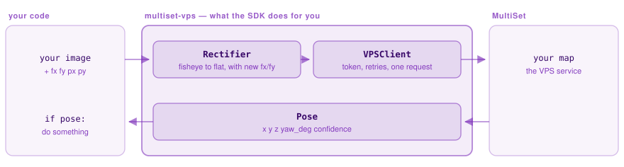

# multiset-vps

### One picture in, a position out.

Part of [multiset-python](../../README.md). This is the **core**: every device
adapter is built on it, and it knows nothing about any particular camera. For the
Unitree Go2, see [`multiset-unitree-go2`](../unitree-go2/README.md).

<picture>
  <source media="(prefers-color-scheme: dark)" srcset="../../docs/img/vps-dark.svg">
  
</picture>

**What it is for.** You have a photograph of somewhere you have already mapped
with MultiSet, and you want to know where it was taken from.

**What you give it.** The image, plus the four numbers that describe your lens
(`fx`, `fy`, `px`, `py`). If your lens is a fisheye, this package will
straighten the picture first and work out the corrected numbers for you. A 360
panorama needs no lens numbers at all — see
[localizing a 360 panorama](#localizing-a-360-panorama).

**What you get back.** A `Pose`: `x`, `y`, `z`, a heading in degrees, and a
confidence. A picture the map cannot place is a normal answer — the `Pose` comes
back empty and falsey, so `if pose:` is the whole check. Exceptions are reserved
for things that are actually broken.

**What it needs.** numpy, opencv-python, requests. No camera, no device, no
hardware, no robot.

### Where your code stops and ours starts

<picture>
  <source media="(prefers-color-scheme: dark)" srcset="../../docs/img/vps-modules-dark.svg">
  
</picture>

You bring the picture and the lens numbers. Everything between that and a `Pose`
— straightening the image, the auth token, the request, parsing the reply — is
this package's job.

---

# Getting started

Three steps. About five minutes.

## 1 · Install it

```bash
pip install "multiset-vps @ git+https://github.com/MultiSet-AI/multiset-python@vps-v0.1.1#subdirectory=packages/vps"
```

Nothing else to install first — numpy, opencv-python and requests come with it.

## 2 · Get your credentials

Sign up at the [MultiSet Developer Platform](https://developer.multiset.ai),
create a map, and you will have three values:

| | |
|---|---|
| `MULTISET_CLIENT_ID` | identifies your account |
| `MULTISET_CLIENT_SECRET` | the password for it |
| `MULTISET_MAP_CODE` | which map to search, like `MAP_XXXXXXXXXX` |

Copy [`.env.example`](../../.env.example) to `.env` next to your script and paste
them in. That is all the setup there is.

## 3 · Localize a picture

Take a photo somewhere inside your map, then:

```python
import cv2
from multiset.vps import PinholeIntrinsics, localize_image

image = cv2.imread("photo.png")

# the four numbers describing your lens, for THIS image size
K = PinholeIntrinsics(fx=728.47, fy=727.57, px=646.64, py=346.46, width=1280, height=720)

pose = localize_image(image, K)

if pose:
    print(f"x={pose.x:.2f}  y={pose.y:.2f}  facing {pose.yaw_deg:.0f}°")
else:
    print("the map did not recognise this picture")
```

`if pose:` is the whole check. A picture the map cannot place is a normal answer,
not an error — you get a `Pose` that is simply empty.

**Where do the four numbers come from?** Whatever took the picture. Your phone or
camera SDK reports them, or you measure them once with a calibration board. If
your lens is a fisheye, see [straightening a fisheye](#straightening-a-fisheye)
below — you must not use raw fisheye numbers here.

There is a runnable version of exactly this in
[`examples/01_localize_a_file.py`](examples/01_localize_a_file.py).

---

# Going further

Nothing below is needed to get your first pose.

## Localizing from a live camera

If you have something that produces frames continuously, give it a `capture()`
method and `localize()` takes it directly:

```python
from multiset.vps import localize

pose = localize(my_camera)  # my_camera.capture() -> Frame
```

That one method is the entire contract:

```python
class FrameSource(Protocol):
    def capture(self) -> Frame: ...  # Frame = (image, intrinsics)
```

It is how [`multiset-unitree-go2`](../unitree-go2/README.md) plugs in, and how
you would add your own camera.

**In a loop, build the client once** — it caches the auth token, so a fresh
client per query means a token request per query:

```python
from multiset.vps import VPSClient, localize

client = VPSClient()
while True:
    pose = localize(my_camera, client=client)
```

## Localizing a 360 panorama

An equirectangular panorama — the 2:1 image a 360 camera produces — localizes
with **no lens numbers**. Its projection is fixed by its shape, so there is
nothing to calibrate.

```python
import cv2
from multiset.vps import localize_panorama

pose = localize_panorama(cv2.imread("panorama.jpg"), attempts=8)
```

| | |
|---|---|
| Shape | 2:1 (width ÷ height between 1.9 and 2.1) |
| Width | at least 2048 px; anything over 4096 px is downscaled to 4096 before upload |
| Lens numbers | none |
| Heading | measured from the centre column of the panorama |

Anything else raises `CalibrationError` before the image is uploaded.

`attempts=` retries a 5xx, which is how the service reports a query server still
starting up. The first query after a quiet spell can take a couple of minutes.

**Chaining fixes.** To use one fix as the search hint for the next query, pass
it through `pose_to_hint()` — the hint is read in a frame where X is flipped, so
the raw position quietly stops helping:

```python
from multiset.vps import VPSClient, pose_to_hint

client = VPSClient()
hint = None
for image in panoramas:
    pose = client.localize_panorama(image, hint_position=hint, hint_radius=15, attempts=8)
    hint = pose_to_hint(pose) if pose else None
```

A camera can plug in the same way as a pinhole one: give it a
`capture_panorama()` method returning a `Panorama`, and `localize()` sends it as
an equirect query. [`multiset-insta360`](../insta360/README.md) does exactly
that for Insta360 X-series cameras.

There is a runnable version in
[`examples/02_localize_a_panorama.py`](examples/02_localize_a_panorama.py). Give
it several images and it chains the hints for you:

```bash
python examples/02_localize_a_panorama.py walk/*.jpg
```

## Straightening a fisheye

VPS needs a flat, pinhole-style picture. A fisheye frame means nothing
geometrically until it is remapped, so do that first:

```python
from multiset.vps import FisheyeCalibration, Rectifier

calib = FisheyeCalibration(
    name="my-lens-1280x720",
    fx=797.47,
    fy=796.48,
    cx=643.53,
    cy=349.27,
    k=(-0.0731, -0.0234, -0.0069, 0.0092),
    width=1280,
    height=720,
)

rect = Rectifier(calib)  # remap tables built once, then cached
image, K = rect.undistort(raw)  # the flat image AND its new numbers
pose = localize_image(image, K)
```

`undistort()` hands back the image **and** its intrinsics together, because they
are only valid as a pair. The resolution is part of the calibration on purpose:
these coefficients describe one sensor at one readout size, and applying them to
a resized frame gives you a plausible picture with wrong geometry.
`undistort()` raises `CalibrationError` rather than let that through.

## Three things that go wrong silently

Each of these produces a believable answer instead of an error, which is exactly
what makes them expensive. Each has one implementation, and it lives here.

**Raw and rectified numbers are not interchangeable.** A fisheye calibration
describes the *sensor*; `PinholeIntrinsics` describes the image *after*
remapping. They differ by roughly 10%. Send raw numbers with a straightened
image and every bearing is ~10% out — and VPS still answers `poseFound: true`.

**VPS answers Y-up; your map is probably Z-up.** Odometry, costmaps and viewers
are Z-up. `YUP_TO_ZUP` converts.

**A pose describes the camera, not the robot carrying it.** Hand
`camera_pose_to_origin()` your device's `Mount` and you get the carrier's pose
instead — it applies `YUP_TO_ZUP` and `CAM_TO_OPTICAL` (VPS reports an
ARKit-style camera frame; mounts are written in OpenCV optical) for you. On a
typical mount the two poses differ by tens of centimetres and often 90° of
heading — and the wrong one looks perfectly fine in a screenshot.

The long version, with the maths, is in [docs/frames.md](../../docs/frames.md).

## Errors

`MultisetError` is the root for every package in the family, so one `except`
covers this package and every device beside it.

```
MultisetError
├─ ConfigError         # no credentials, no map code
├─ CalibrationError    # frame does not match its calibration
├─ CameraError         # a frame source produced nothing
│  └─ FrameTimeout
└─ VPSError
   └─ VPSAuthError     # check MULTISET_CLIENT_ID / _SECRET
```

This library never calls `sys.exit()`, and an unrecognised picture is not an
error — check `if pose:`.

## Passing settings explicitly

`.env` is a convenience, not a requirement. Nothing is read at import time, and
an explicit value always wins:

```python
from multiset.vps import VPSClient, VPSSettings

client = VPSClient(VPSSettings(client_id="…", client_secret="…", map_code="MAP_…"))
```

These credentials belong to your MultiSet **account**, not to any one device —
which is why they live here rather than in a robot's settings.

## Licence

Apache-2.0. See [LICENSE](LICENSE) and [NOTICE](NOTICE).
